<div align="center">


# Eventra

**Find something worth circling on the calendar.**<br/>
Browse events, book tickets, leave reviews and run your own events, all on a serverless AWS stack.


<br/>

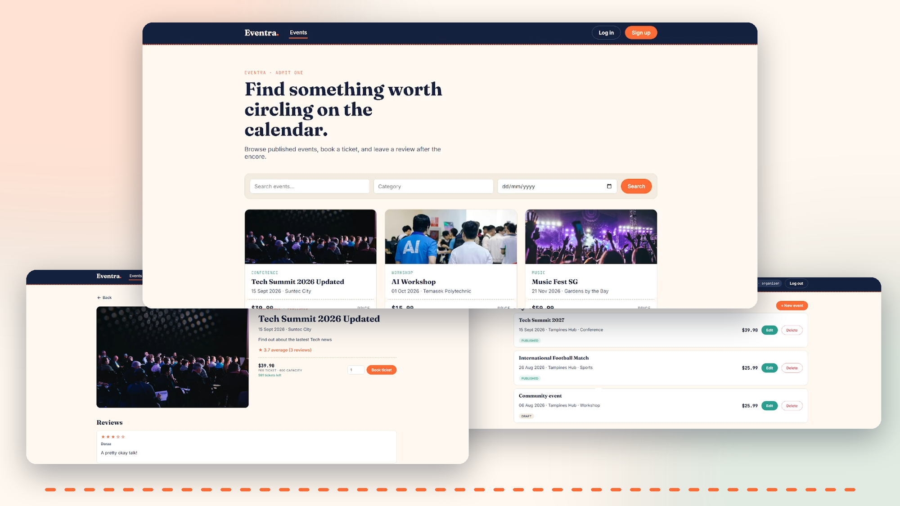

</div>

<br/>

## Contents

- [Overview](#overview)
- [Features at a glance](#features-at-a-glance)
- [Design](#design)
- [Authentication](#authentication)
- [Browse and search](#browse-and-search)
- [Event details and booking](#event-details-and-booking)
- [Reviews](#reviews)
- [Organizer tools](#organizer-tools)
- [Profile](#profile)
- [Validation and feedback](#validation-and-feedback)
- [Architecture](#architecture)
- [API reference](#api-reference)
- [Getting started](#getting-started)
- [Notes](#notes)

## Overview

Eventra is a cloud event booking platform. **Attendees** can browse and search published events, see how many tickets are left, book and cancel tickets, and leave a star review after the event. **Organizers** get their own space to create, edit and delete events, upload an event image, and watch bookings and revenue on a dashboard.


> [!NOTE]
> Eventra is a student project. Event names, prices and photos are sample data for demonstration, and no real payments take place.


## Features at a glance

| Area | What it does |
|---|---|
| **Authentication** | Sign up with a live password-rule checklist, email confirmation code, log in, log out, forgot and reset password, edit profile, delete account. Cognito and the database are kept in sync |
| **Browse and search** | Published events as ticket-style cards, with keyword, category and date filters |
| **Event details** | Image, description, average star rating, price, capacity and a live **tickets left** count |
| **Booking** | Book tickets with quantity limits, view them under **My tickets**, cancel a booking |
| **Reviews** | Star rating and comment, reviewer names shown, one review per person per event, edit and delete your own |
| **Organizer tools** | **My events** with draft, published and cancelled badges, create and edit events, image upload straight to S3, delete events |
| **Dashboard** | Total revenue, total bookings and per-event bookings and revenue |
| **Roles** | Organizers cannot book tickets or post reviews, and attendees never see organizer pages |
| **Feedback** | Inline field validation, toast messages and themed confirmation dialogs instead of browser pop-ups |
| **Backend** | 28 REST endpoints across 4 Lambda services, with a 43-request Postman collection (12 of them error cases) |

## Design

The project started on paper: who uses it, what they do, and what each screen looks like.

<div align="center">
<table>
  <tr>
    <td align="center" valign="top">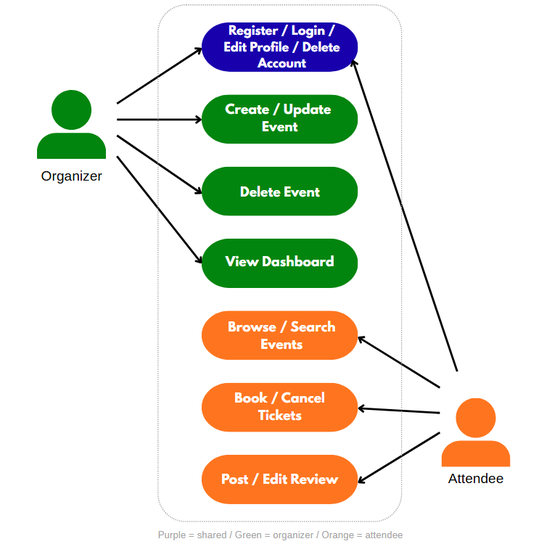<br/><sub><b>Use cases</b></sub></td>
    <td align="center" valign="top">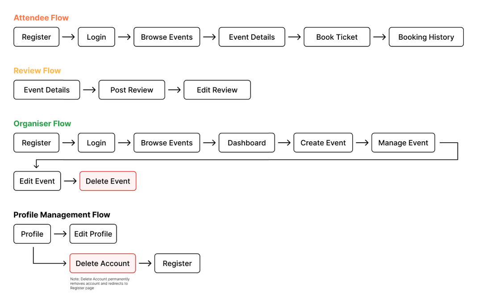<br/><sub><b>User flows</b></sub></td>
  </tr>
</table>
</div>

<details>
<summary><b>Low-fidelity prototypes</b></summary>

<br/>

<div align="center">

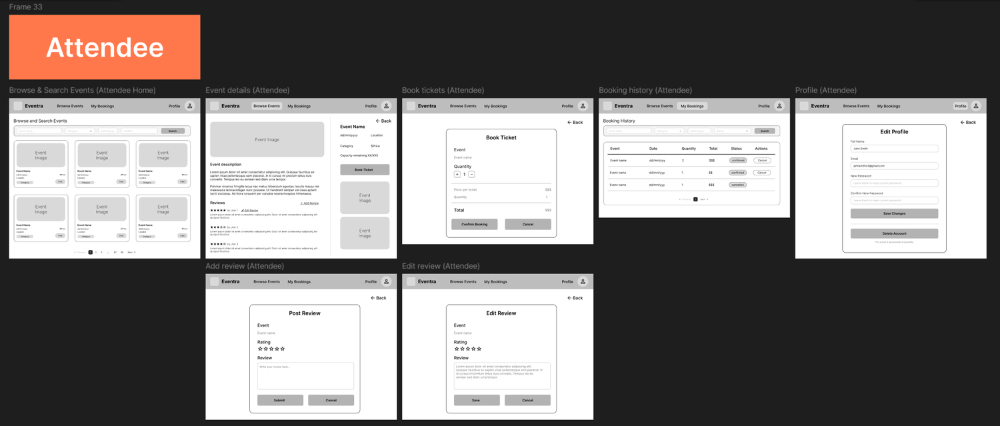<br/><sub><b>Attendee</b></sub>

<br/><br/>

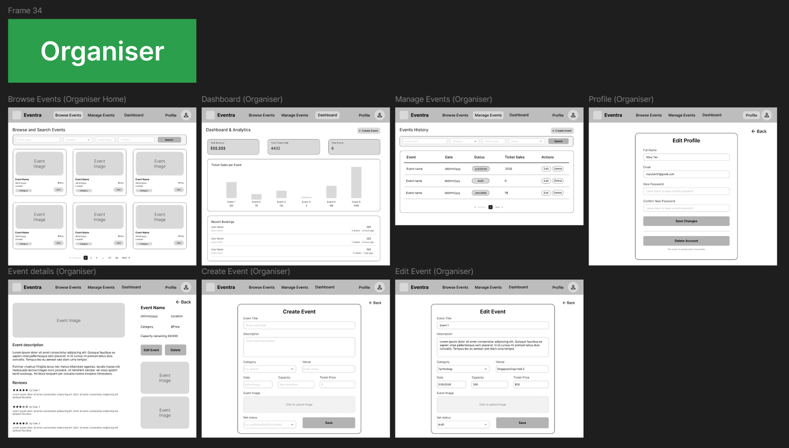<br/><sub><b>Organizer</b></sub>

<br/><br/>

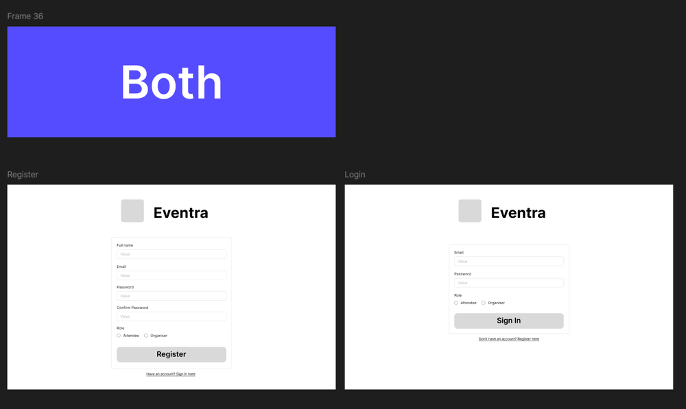<br/><sub><b>Register and login (both roles)</b></sub>

</div>

</details>

These wireframes were the starting point for the screens. The built app adds its own visual identity: a warm paper background, a navy header with a dashed "ticket perforation" edge, and event cards styled like ticket stubs. Headings use **Fraunces**, body text uses **Inter**, and prices use **JetBrains Mono**.

## Authentication

<div align="center">
<table>
  <tr>
    <td align="center" valign="top" width="320">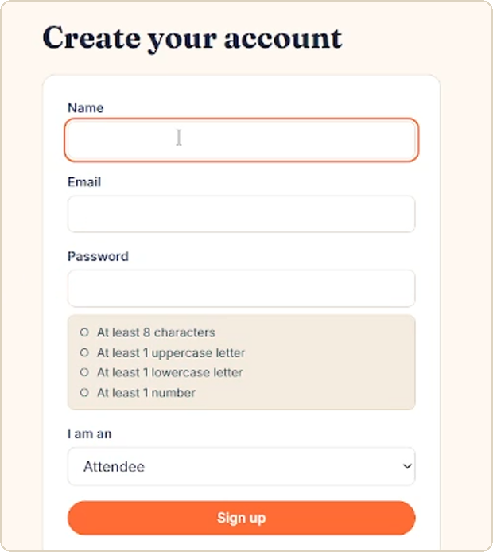</td>
    <td valign="top">
      <ul>
        <li><b>Sign up</b> with name, email, password and a role (attendee or organizer).</li>
        <li>A <b>live checklist</b> ticks off each password rule as you type: 8+ characters, an uppercase letter, a lowercase letter and a number. It mirrors the Cognito pool's password policy, so mistakes are caught before a request is sent.</li>
        <li>A <b>confirmation code</b> is emailed by Cognito. After sign-up the app moves straight to the confirm screen, then to login.</li>
        <li><b>Forgot password</b> sends a reset code and takes you to a new-password screen.</li>
        <li>Email format is checked inline on sign-up and on the profile form.</li>
      </ul>
    </td>
  </tr>
</table>
</div>

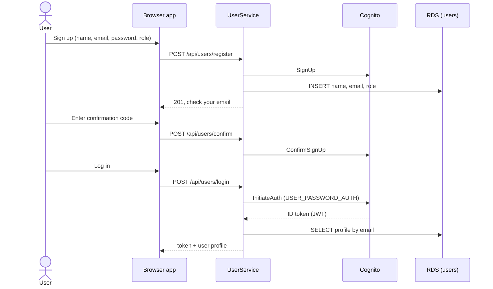

Passwords are never stored by Eventra. **Cognito is the only place credentials live**, and the `users` table keeps just the profile (name, email, role).

## Browse and search

<div align="center">
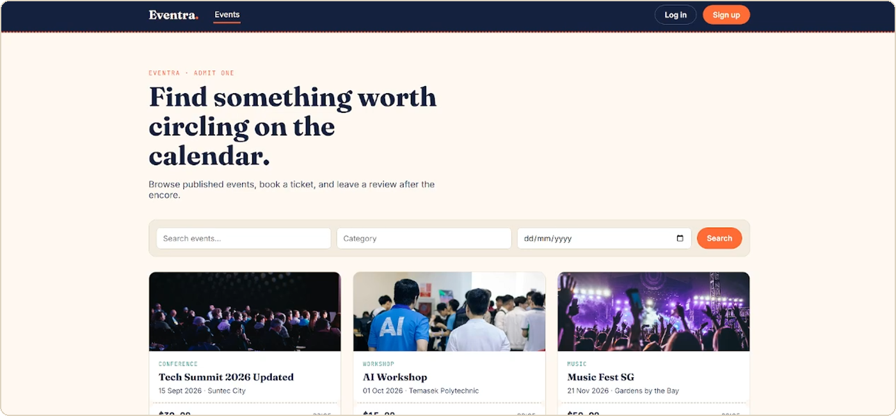<br/>
<sub><b>Events homepage</b></sub>
</div>

<br/>

<div align="center">
<table>
  <tr>
    <td align="center" valign="top">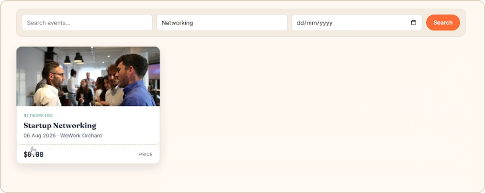<br/><sub><b>Filter by category</b></sub></td>
    <td align="center" valign="top">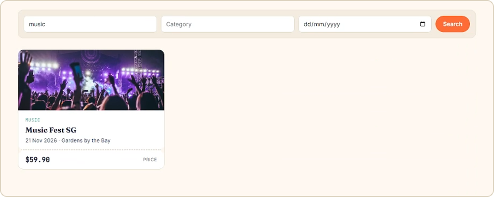<br/><sub><b>Search by keyword</b></sub></td>
  </tr>
  <tr>
    <td align="center" valign="top" colspan="2">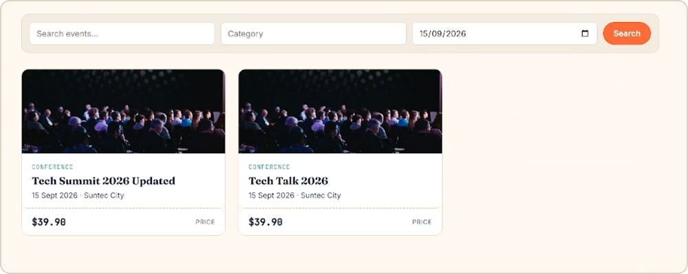<br/><sub><b>Filter by date</b></sub></td>
  </tr>
</table>
</div>

- The homepage lists **published** events only. Drafts and cancelled events stay hidden from the public.
- Keyword search matches the title and description. Category and date narrow the list further, and the three can be combined.
- Each card shows the event image, category, title, date, venue and ticket price.

## Event details and booking

<div align="center">
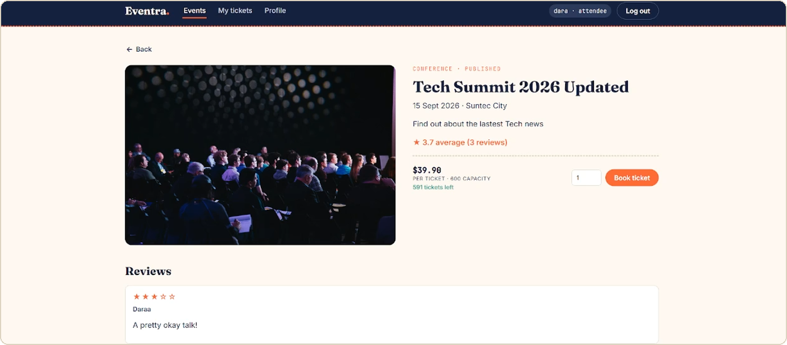<br/>
<sub><b>Event details for a signed-in attendee</b></sub>
</div>

- Shows the image, description, **average rating** and the number of reviews.
- **Tickets left** appears next to the price for signed-in users, in teal normally, coral when 10 or fewer remain, and red as **Sold out**, which also replaces the booking form with a disabled button.
- The quantity box is capped at the tickets left, so it cannot be set above what is available.
- A **Back** button returns to wherever you came from.
- **My tickets** lists every booking with its quantity, unit price at the time of booking, total and status, and lets you cancel one. Cancelling asks for confirmation first.
- Organizers see a short note instead of a booking form.

## Reviews

<div align="center">
<table>
  <tr>
    <td align="center" valign="top">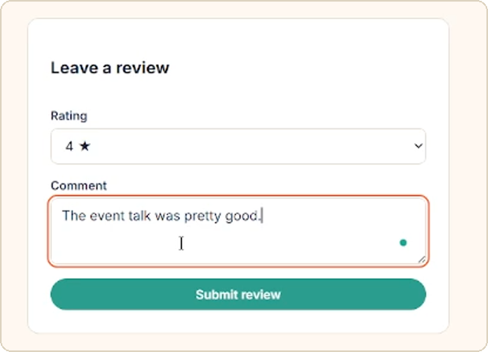<br/><sub><b>Leave a review</b></sub></td>
    <td align="center" valign="top">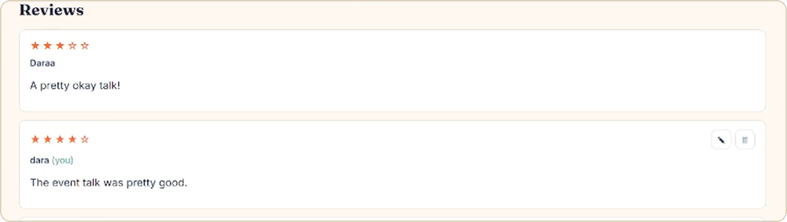<br/><sub><b>Your review, with edit and delete</b></sub></td>
  </tr>
</table>
</div>

- Pick **1 to 5 stars** and write a comment. Reviews are stored in **DynamoDB**.
- Reviews only store a user id, so the app looks up each reviewer's name once per page load and shows it between the stars and the comment. Your own review is tagged **(you)**.
- The pencil and bin icons appear **only on your own review**. Edit swaps the review for an inline form, delete asks for confirmation.
- One review per person per event: once you have reviewed an event, the form is replaced by your review.

## Organizer tools

<div align="center">
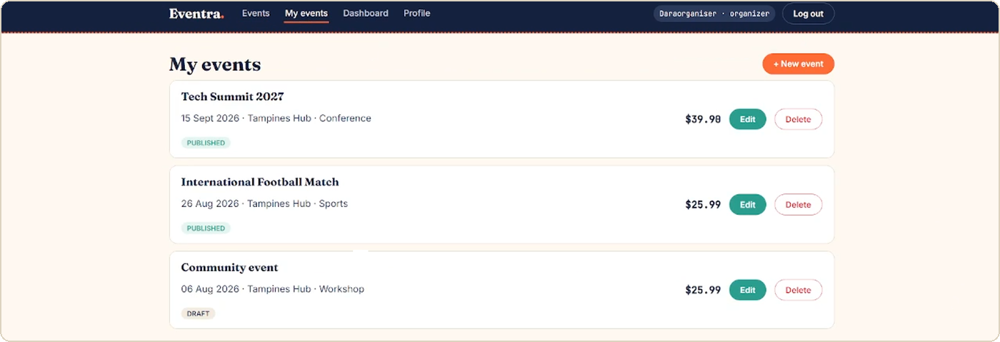<br/>
<sub><b>My events</b></sub>
</div>

<br/>

<div align="center">
<table>
  <tr>
    <td align="center" valign="top">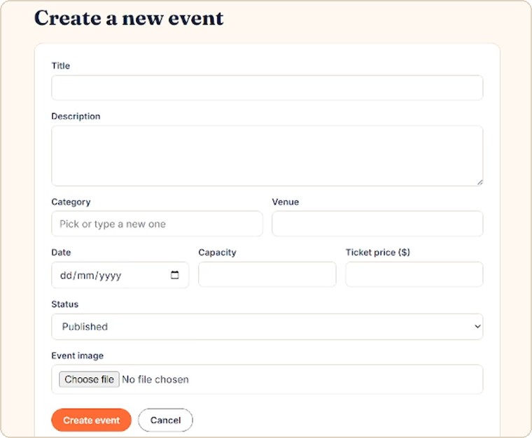<br/><sub><b>Create</b></sub></td>
    <td align="center" valign="top">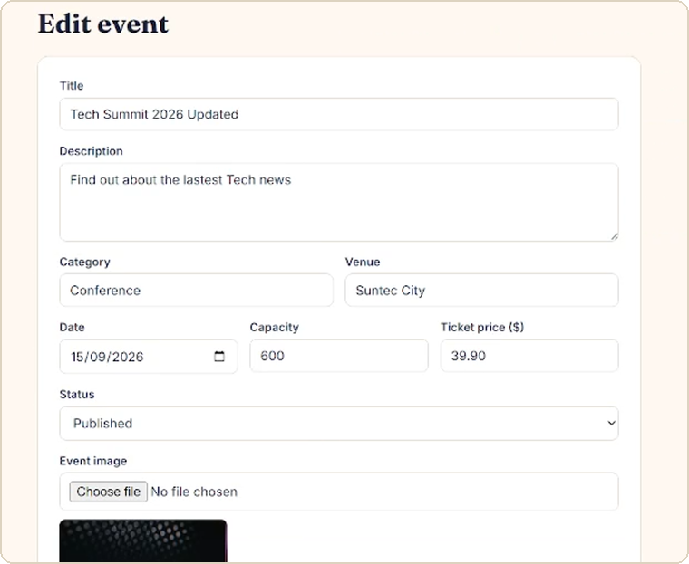<br/><sub><b>Edit</b></sub></td>
  </tr>
</table>
</div>

<div align="center">
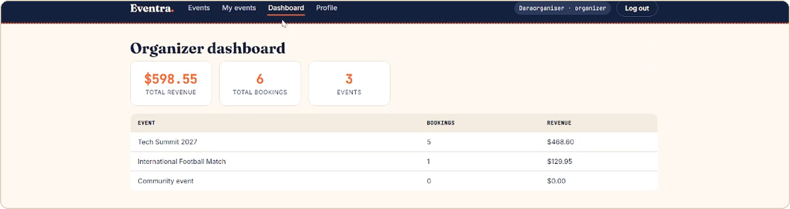<br/>
<sub><b>Organizer dashboard</b></sub>
</div>

- **My events** lists everything the organizer owns, including **draft** and **cancelled** events that the public never sees, with price, status badge, Edit and Delete.
- The **category** field suggests the categories already in use but lets you type a new one. New categories and venues are created automatically by the API.
- **Image upload** goes browser to S3 using a short-lived presigned URL, so no AWS credentials ever reach the browser:

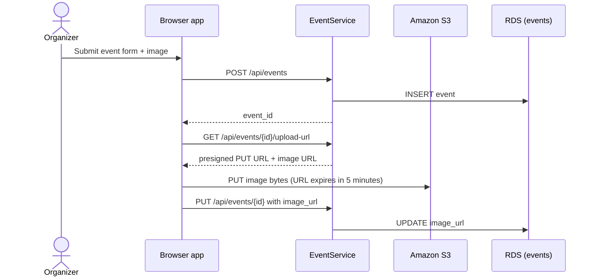

- The **dashboard** shows total revenue, total bookings and number of events, plus a table of bookings and revenue per event. Only confirmed bookings count, so cancelling a ticket removes it from the totals.

## Profile

<div align="center">
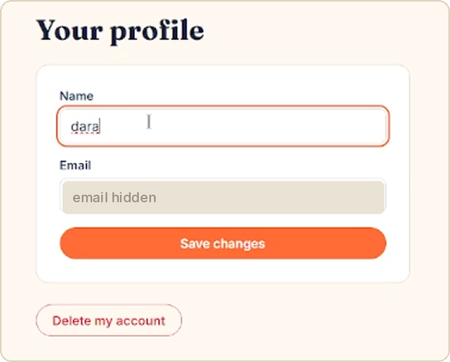<br/>
<sub><b>Profile</b> (email hidden for privacy)</sub>
</div>

- Update your name and email, with the same inline email check used at sign-up.
- **Delete my account** removes the user from **both** Cognito and the database, so the two stay in step.

## Validation and feedback

<div align="center">
<table>
  <tr>
    <td align="center" valign="top">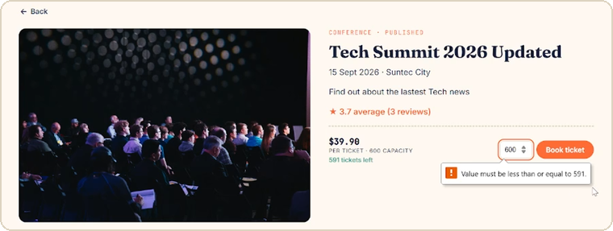<br/><sub><b>More than the tickets left</b></sub></td>
    <td align="center" valign="top">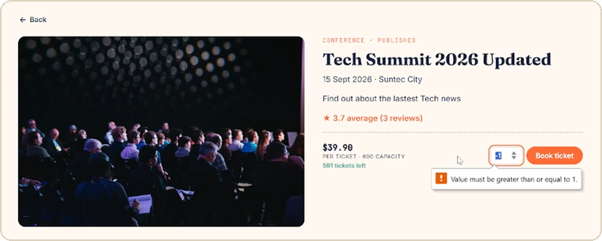<br/><sub><b>Less than 1</b></sub></td>
  </tr>
</table>
</div>

- **Inline** messages for fixing a field: the password checklist, the email hint, and quantity limits.
- **Toasts** for what just happened (booked, review posted, something failed).
- **Themed confirmation dialogs** before anything destructive: deleting an event, a review or an account, and cancelling a booking.
- The API replies with clear status codes: `400` for missing or invalid fields, `401` for a wrong email or password, `403` for an unconfirmed account, `404` for something that does not exist, and `409` for conflicts such as a duplicate email, a duplicate review or cancelling a booking twice.
- Login failures are deliberately generic ("Incorrect email or password") so the API does not reveal which emails have accounts.

## Architecture

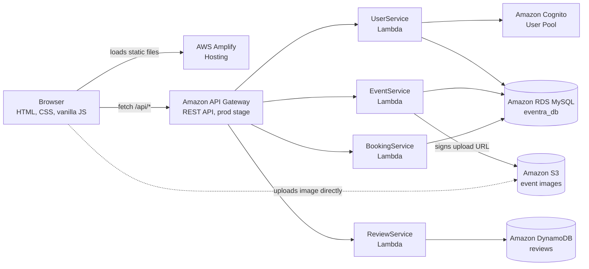

Amplify only **delivers** the static files. Everything dynamic goes through API Gateway to one of four Lambda services, each owning one area of the app.

| Service | Responsibility |
|---|---|
| **AWS Amplify** | Hosts the five static files and redeploys on every push to GitHub, with HTTPS included |
| **Amazon API Gateway** | One REST API (`prod` stage) routing `/api/users`, `/api/events`, `/api/bookings` and `/api/reviews` to the right Lambda, with CORS enabled |
| **AWS Lambda** | `UserService`, `EventService`, `BookingService` and `ReviewService` (Node.js), one per domain |
| **Amazon Cognito** | Owns credentials: sign-up, email confirmation, login (issues a JWT), password reset and the password policy |
| **Amazon RDS (MySQL)** | One schema, `eventra_db`: users, categories, venues, events and bookings |
| **Amazon DynamoDB** | Reviews, keyed so that "all reviews for event X" is a single efficient query |
| **Amazon S3** | Event images, uploaded with presigned URLs and read publicly by URL |
| **Amazon CloudWatch** | Lambda logs, used to debug failures |

<details>
<summary><b>Database design</b></summary>

<br/>

**MySQL (`eventra_db`)**

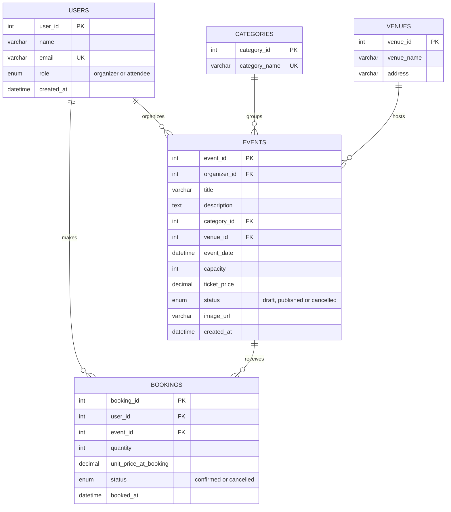

**DynamoDB (`reviews`)**

| Attribute | Role |
|---|---|
| `event_id` (String) | Partition key |
| `review_id` (String) | Sort key. A global secondary index, `review_id-index`, allows looking a single review up by id |
| `user_id`, `rating` (1-5), `comment`, `created_at` | Review data |

A booking's total is never stored. It is calculated as `quantity x unit_price_at_booking`, and the price is copied at booking time so later price changes never rewrite history.

<br/>

| Part 1 design | Final design | Why |
|---|---|---|
| `users.password` column | Removed | Cognito is the only credential store, so the app never handles password hashes |
| `events.category` and `events.venue` as text | Separate `categories` and `venues` tables, linked by id | Removes repeated text and gives clean filters. The API creates new entries automatically |
| `bookings.total_price` | `unit_price_at_booking`, with the total calculated | Keeps a snapshot of the price paid and avoids storing a value that can drift |
| `reviews` in MySQL | `reviews` in DynamoDB, with a partition and sort key | Reviews are always fetched per event, which suits a key-value store |
| Separate databases per service | One `eventra_db` schema shared by the three SQL services | Project requirement |

</details>

<details>
<summary><b>Project structure</b></summary>

```text
.
├── index.html                  # App shell: header, nav, footer
├── styles.css                  # Design system (ticket-stub theme, light surfaces)
├── config.js                   # API Gateway base URL
├── api.js                      # One function per endpoint, plus auth/session helpers
├── app.js                      # Hash router and every page view
├── lambda/                     # Backend source, one folder per Lambda
│   ├── UserService/
│   ├── EventService/
│   ├── BookingService/
│   └── ReviewService/
└── docs/
    ├── DEPLOYMENT.md           # Amplify / S3 + CloudFront / S3 bucket setup
    ├── postman/                # Postman collection for all endpoints
    └── images/                 # Screenshots and diagrams used in this README
```

</details>

### Tech stack

| Purpose | Technology |
|---|---|
| Frontend | HTML, CSS and vanilla JavaScript, with a hash-based router (no framework, no build step) |
| Hosting | AWS Amplify, connected to GitHub |
| API | Amazon API Gateway (REST) |
| Compute | AWS Lambda (Node.js), `mysql2`, AWS SDK v3 |
| Auth | Amazon Cognito (`USER_PASSWORD_AUTH`) |
| Relational data | Amazon RDS for MySQL |
| Reviews | Amazon DynamoDB |
| Images | Amazon S3 with presigned upload URLs |
| API testing | Postman |
| Fonts | Fraunces, Inter and JetBrains Mono (Google Fonts) |

## API reference

Every endpoint is served from one API Gateway base URL (`prod` stage). The Postman collection in [`docs/postman`](docs/postman/CADV_Project_Part_2_postman_collection.json) covers all of them, including **12 error-case requests** such as invalid ids, nonexistent records and cancelling twice.

<details>
<summary><b>UserService</b> (<code>/api/users</code>)</summary>

| Method | Route | Purpose |
|---|---|---|
| POST | `/api/users/register` | Create the Cognito user and the profile row |
| POST | `/api/users/confirm` | Confirm email with the emailed code |
| POST | `/api/users/login` | Returns a JWT and the user profile |
| POST | `/api/users/forgot-password` | Send a reset code |
| POST | `/api/users/reset-password` | Set a new password with the code |
| GET | `/api/users` | List users, optional `?name=` |
| GET | `/api/users/{id}` | One user |
| PUT | `/api/users/{id}` | Update name and email |
| DELETE | `/api/users/{id}` | Delete from Cognito and the database |

</details>

<details>
<summary><b>EventService</b> (<code>/api/events</code>, <code>/api/analytics</code>)</summary>

| Method | Route | Purpose |
|---|---|---|
| POST | `/api/events` | Create an event (category and venue are resolved by name) |
| GET | `/api/events` | Published events, optional `?keyword=`, `?category=`, `?date=` |
| GET | `/api/events/{id}` | One event with category and venue names |
| PUT | `/api/events/{id}` | Update an event, including its `image_url` |
| DELETE | `/api/events/{id}` | Delete an event |
| GET | `/api/events/{id}/upload-url` | Presigned S3 upload URL and the final image URL |
| GET | `/api/analytics/events/{eventId}` | Total bookings and revenue for one event |
| GET | `/api/analytics/organizer/{organizerId}` | Bookings and revenue per event for an organizer |

</details>

<details>
<summary><b>BookingService</b> (<code>/api/bookings</code>)</summary>

| Method | Route | Purpose |
|---|---|---|
| POST | `/api/bookings` | Book tickets. The price is read from the event and stored as `unit_price_at_booking` |
| GET | `/api/bookings` | All bookings |
| GET | `/api/bookings/{id}` | One booking |
| GET | `/api/bookings/user/{userId}` | A user's bookings |
| GET | `/api/bookings/event/{eventId}` | Bookings for an event |
| DELETE | `/api/bookings/{id}` | Cancel (sets status to `cancelled`, `409` if already cancelled) |

</details>

<details>
<summary><b>ReviewService</b> (<code>/api/reviews</code>)</summary>

| Method | Route | Purpose |
|---|---|---|
| POST | `/api/reviews` | Post a review. Rating must be 1 to 5, and `409` if the user already reviewed the event |
| GET | `/api/reviews/{id}` | One review, found through the `review_id-index` |
| GET | `/api/reviews/event/{eventId}` | All reviews for an event |
| PUT | `/api/reviews/{id}` | Update rating and comment |
| DELETE | `/api/reviews/{id}` | Delete a review |

</details>

## Getting started

### Prerequisites

- An AWS account with the Part 2 backend deployed (API Gateway, the four Lambdas, RDS, DynamoDB, S3 and a Cognito user pool)
- Git, and any static file server for local testing (Python is enough)

### 1. Clone

```bash
git clone <your-repo-url>
cd <your-repo-folder>
```

### 2. Point the app at your API

Open `config.js` and set the base URL of your API Gateway `prod` stage:

```js
const CONFIG = {
  API_BASE_URL: "https://<api-id>.execute-api.<region>.amazonaws.com/prod"
};
```

### 3. Backend configuration

Each Lambda reads its settings from environment variables. Nothing secret is committed to this repository.

| Lambda | Environment variables |
|---|---|
| `UserService` | `DB_HOST`, `DB_USER`, `DB_PASS`, `COGNITO_CLIENT_ID`, `COGNITO_USER_POOL_ID` |
| `EventService` | `DB_HOST`, `DB_USER`, `DB_PASS` |
| `BookingService` | `DB_HOST`, `DB_USER`, `DB_PASS` |
| `ReviewService` | none (uses its IAM role to reach DynamoDB) |

- Set the Cognito pool's password policy to match the app: minimum 8 characters, with a number, an uppercase and a lowercase letter.
- The three SQL services need network access to the RDS instance, and the `EventService` role needs `s3:PutObject` on the image bucket.
- Enable **CORS** on the API (allow `Content-Type` and `Authorization`, and the `GET`, `POST`, `PUT`, `DELETE` and `OPTIONS` methods), then **redeploy the `prod` stage**.

> [!TIP]
> CORS changes on a REST API only take effect after the stage is redeployed. If the browser shows a CORS error right after you enabled it, redeploy first.

### 4. Image bucket

Uploads need a **CORS rule** on the bucket, and images need **public read** access to be displayed. The exact JSON for both is in [`docs/DEPLOYMENT.md`](docs/DEPLOYMENT.md#6-s3-image-bucket-needed-for-event-images).

### 5. Run locally

```bash
python3 -m http.server 8080
# open http://localhost:8080
```

### 6. Deploy

Push to GitHub and connect the repository in **AWS Amplify**. There is no build step, so the build settings only need to publish the repository root. The full walkthrough, including an S3 + CloudFront option, is in [`docs/DEPLOYMENT.md`](docs/DEPLOYMENT.md).

## Notes

- **No automated tests.** The API was tested with the Postman collection, and the app by hand against the live deployment.
- Sample event photos are stock images used for demonstration only.


### Acknowledgements

- [AWS documentation](https://docs.aws.amazon.com/) for Lambda, API Gateway, Cognito, RDS, DynamoDB, S3 and Amplify
- [Google Fonts](https://fonts.google.com/): Fraunces, Inter and JetBrains Mono
- [shields.io](https://shields.io/) for the badges at the top of this page
